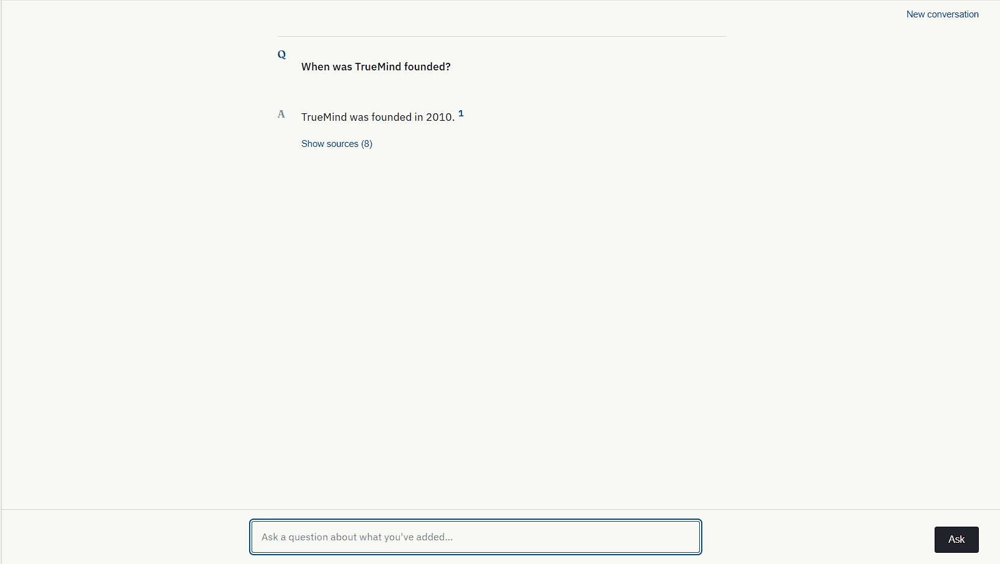
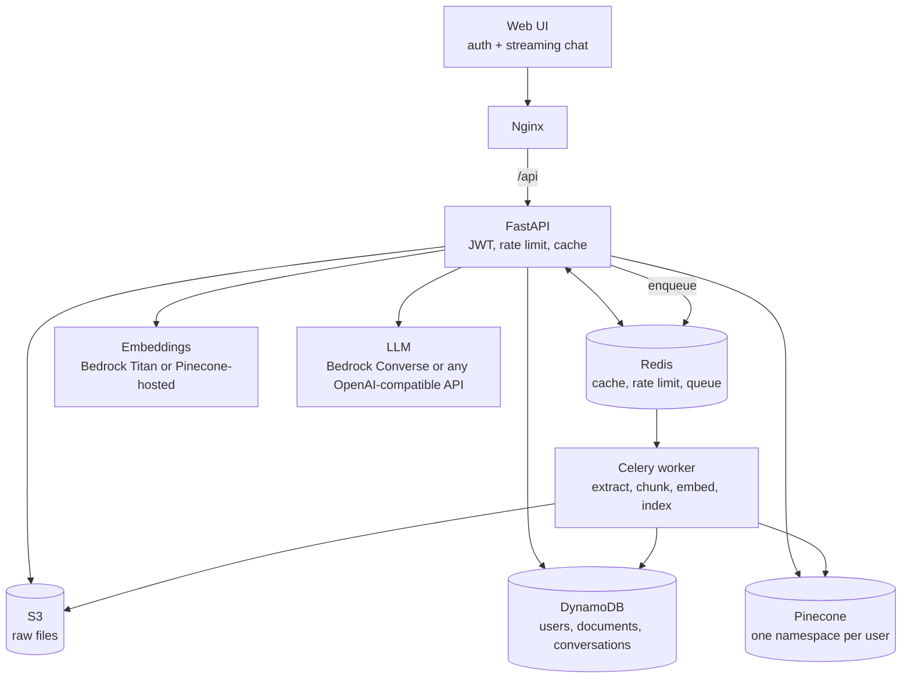

# Docklight

[](https://github.com/arjun-singh-negi-star/Docklight/actions/workflows/ci-cd.yaml)



A multi-tenant **RAG (retrieval-augmented generation)** assistant. Users sign up, upload documents, and ask
questions that are answered **only from their own documents**, streamed live, with clickable source citations,
conversation memory, and replies in the language they asked in (Hinglish, Hindi, Chinese, Korean, ...).

**Stack:** FastAPI · Celery + Redis · Pinecone · AWS (S3, DynamoDB, Bedrock, Secrets Manager) · Docker ·
Kubernetes (EKS) · Terraform · GitHub Actions

[](https://github.com/arjun-singh-negi-star/Docklight/actions/workflows/ci-cd.yaml)

## Verification status

| Area | Status |
|---|---|
| Local stack (FastAPI, Celery worker, Redis, LocalStack, Nginx UI) via Docker Compose | **Run end-to-end** |
| Pinecone-hosted embeddings + an OpenAI-compatible LLM (Groq) | **Run end-to-end**: upload, background indexing, hybrid retrieval, streaming answers, conversation memory, multilingual replies |
| Automated tests | **72 tests** (moto, fakeredis, mocks); `ruff` and `bandit` clean |
| AWS Bedrock provider (Titan embeddings + Converse API) | Implemented and unit-tested with mocks. **Not run against live Bedrock**: the AWS account was still under verification |
| Terraform, EKS/Kubernetes manifests, CI image push | Written and syntax-validated. **Not applied to a live AWS account or cluster** |

## Architecture



Embedding and LLM providers are switched with environment variables only (no code change), see below.

## Quick start (Docker Compose)

```bash
cp .env.example .env
```

Set `JWT_SECRET_KEY` to a random value: `openssl rand -hex 32`, or in PowerShell:
`-join ((1..32) | ForEach-Object { "{0:x2}" -f (Get-Random -Minimum 0 -Maximum 256) })`

Set `PINECONE_API_KEY` (a free Pinecone account is enough), then choose **one** mode in `.env`:

- **Mode A: AWS Bedrock** (default). Needs a Bedrock-enabled AWS account: set `BEDROCK_ACCESS_KEY_ID` /
  `BEDROCK_SECRET_ACCESS_KEY` and the model ids.
- **Mode B: no Bedrock.** Uncomment the *Mode B* block in `.env.example`: Pinecone-hosted embeddings plus any
  OpenAI-compatible LLM (Groq, Gemini's OpenAI endpoint, OpenAI, a local Ollama...). Use a different
  `PINECONE_INDEX_NAME` per mode: vectors from different embedding models are not comparable.

```bash
docker compose up --build
```

UI at http://localhost:8080 (sign up, upload a file, wait for status **indexed**, ask). API docs at
http://localhost:8000/docs. If those ports are taken, set `FRONTEND_PORT` / `BACKEND_PORT` in `.env`.
Fake AWS data lives in LocalStack's memory: `docker compose down` wipes it, so sign up again afterwards.
Optional demo data: `python scripts/seed_fake_data.py --email <you> --password <min 8 chars>`.

## Tests

```bash
cd backend
pip install -r requirements-dev.txt
pytest -q --cov=app        # AWS is mocked with moto, Redis with fakeredis, model calls with mocks
ruff check app tests
bandit -r app -ll
```

## Deploying to AWS (untested here, see status above)

1. `infra/terraform`: S3, DynamoDB (3 tables + GSIs), ECR, Secrets Manager, IAM policy. Run `terraform plan` first.
2. `infra/eks-cluster.yaml`: `eksctl create cluster -f infra/eks-cluster.yaml`, then bind the IAM policy to a service
   account (IRSA) instead of storing AWS keys.
3. Build and push images (`scripts/build_and_push.sh`), put the image names in `k8s/*-deployment.yaml`.
4. `cp k8s/secret-template.yaml k8s/secret.yaml`, fill it in (git-ignored), then `scripts/deploy_k8s.sh`.

`.github/workflows/ci-cd.yaml` runs lint, tests with a coverage gate, then builds, scans (Trivy) and pushes images
on `main`, but only after you set the repository variable `ENABLE_ECR_PUSH=true` and add
`AWS_ACCESS_KEY_ID` / `AWS_SECRET_ACCESS_KEY` as repository secrets. Until then, lint and tests still run on every push.

## API

| Endpoint | Auth | Purpose |
|---|---|---|
| `POST /api/auth/signup`, `/login` | none | Returns a JWT |
| `POST /api/documents/upload` | Bearer | Store file, queue background indexing |
| `GET /api/documents`, `DELETE /api/documents/{id}` | Bearer | List / delete your documents (ownership checked) |
| `POST /api/chat/query` | Bearer | Answer in one response (cached when stateless) |
| `POST /api/chat/stream` | Bearer | Server-Sent-Events stream: `sources`, `token`, `error`, `done` |
| `GET /health`, `GET /metrics` | none | Probes, Prometheus metrics |

## Design decisions

- **Tenancy:** one Pinecone index, one namespace per user; S3 keys prefixed by user id; ownership checked on delete.
- **Async ingestion:** uploads return immediately; a Celery worker pool (scaled separately in Kubernetes) does the work.
- **Deletion by id:** vector ids are stored in DynamoDB at index time, so deletes work on any Pinecone plan.
- **Hybrid retrieval:** Pinecone similarity blended with BM25 over the candidate pool. For languages without spaces
  (Chinese, Japanese) BM25 contributes nothing and the order falls back to the multilingual embeddings (tested).
- **Grounding:** strict system prompt plus a per-request reminder. This is a mitigation against prompt injection,
  not a guarantee.
- **Language:** the reply language is enforced per request by detecting the question's script in code
  (Hinglish stays Roman, Devanagari/CJK/Hangul/Arabic/Cyrillic stay in their script).
- **Streaming with auth:** the browser's `EventSource` cannot send an `Authorization` header, so the UI reads the
  SSE stream with `fetch`. Errors arrive as an `error` event instead of a silent break.
- **Cost control:** per-user Redis rate limit, response cache, bounded conversation history.
- **Providers:** embeddings and LLM are swappable by configuration (Bedrock Converse API / OpenAI-compatible).

## Known limitations

- Follow-up questions are retrieved using only the latest message (no query rewriting), so pronoun-heavy
  follow-ups can pull the wrong chunks or over-answer.
- Multi-hop or verify-a-claim questions (for example "is 72% correct?") can fail when the needed numbers sit in
  different chunks; the model may repeat the claim instead of recomputing it.
- Free LLM tiers rate-limit by tokens per minute; the client retries 429s, but rapid-fire questions can still wait.
- JWT is kept in `localStorage` (simple, but weaker against XSS than httpOnly cookies).
- UI labels are English; only the answers follow the user's language.
- LocalStack's free tier does not emulate Bedrock, so model calls always go to real providers.

## Roadmap

Query rewriting / agentic multi-step retrieval · cross-encoder reranking · OpenTelemetry tracing · usage dashboard ·
httpOnly-cookie auth · Terraform remote state and per-environment workspaces.

## License

MIT, see [LICENSE](LICENSE).
